<picture>
  <source media="(prefers-color-scheme: dark)" srcset="./dark.svg">
  <source media="(prefers-color-scheme: light)" srcset="./light.svg">
  
</picture>

 

I'm **Niko R. Polistico**, a **software developer** based in **Butuan City, Philippines**, and a BSIT *cum laude* graduate of Caraga State University. I design and develop web-based systems — from database design to the user interface — with a growing focus on applied AI and blockchain.

## 🧭 Focus

- **Web systems** — Vue 3 + TypeScript front ends on Supabase / PostgreSQL back ends
- **Databases** — PostgreSQL functions, stored procedures, views, and indexing
- **Blockchain** — permissioned ledgers with Hyperledger Fabric
- **Applied AI** — self-supervised learning, LLMs, and retrieval-augmented generation (RAG)

## 🛠️ Featured Projects

### Decentralized Crime Reporting Platform
*A Decentralized Crime Reporting Platform: Utilizing Hyperledger Fabric for a Simulated Blockchain Implementation*

Crime reporting built on a simulated blockchain implementation with **Hyperledger Fabric**.

### Self-Supervised Dragon Fruit Grading
*Self-Supervised Learning: Label-Efficient Maturity and Quality Grading of Dragon Fruit with an Integrated Inventory System for Caraga Growers*

Label-efficient maturity and quality grading of dragon fruit using **self-supervised learning**, paired with an **inventory system** for growers in Caraga.

## 💼 Experience

- **Software Development & Virtual Assistance** — building systems and supporting clients
- **Intern, Police Station 1 — Butuan City** — developed internal systems

## 🎓 Education

- **BSIT, Cum Laude (2026)** — Caraga State University, Butuan City
- Civil Service eligibility — Honor Graduate

## 📜 Certifications & Training

- **CCEP** — Certified Cybersecurity Educator Professional
- **CSCRB** — Certified Security Code Review Beginners
- **Cisco Networking Academy Program**
- **Core Generative AI Skills** — DICT-ITU DTC Initiative, through Cisco Networking Academy
- **RAG with MongoDB** — MongoDB Skill badge for *Building RAG Apps Using MongoDB* (Oct 2026)
- Training in **LLMs**, **AI & RAG**, and **Blockchain**

## ⚙️ Engineering Stack

| Category | Technologies |
|---|---|
| **Frontend** |     |
| **Backend** |      |
| **Database** |   |
| **DevOps & Deployment** |    |
| **Blockchain** |  |
| **AI Tools** |     |

## 📊 GitHub Activity

  
  

## 🤝 Connect

<!-- Add more links here, e.g. LinkedIn or email:

-->
